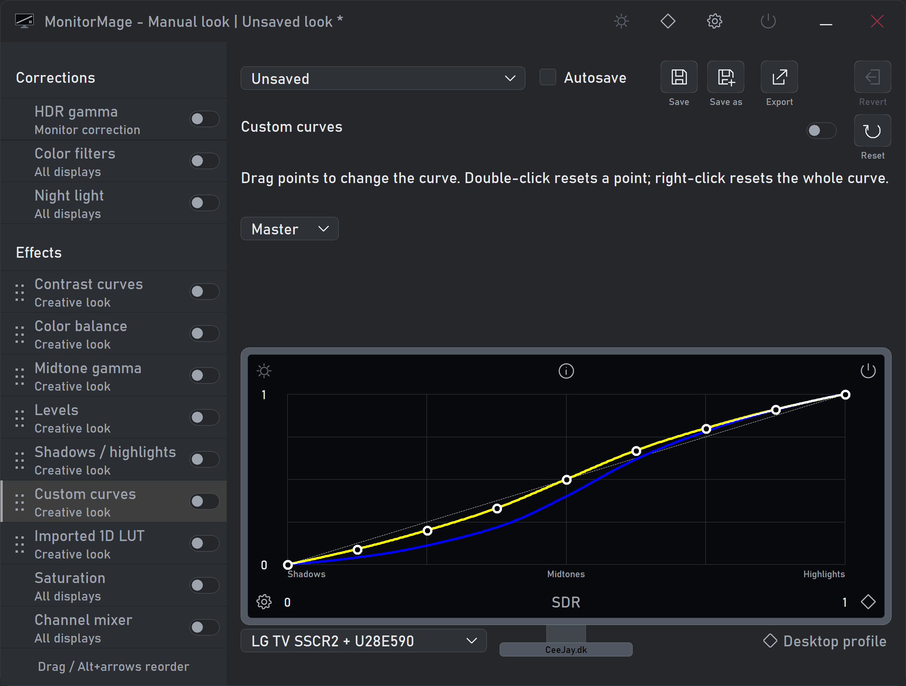
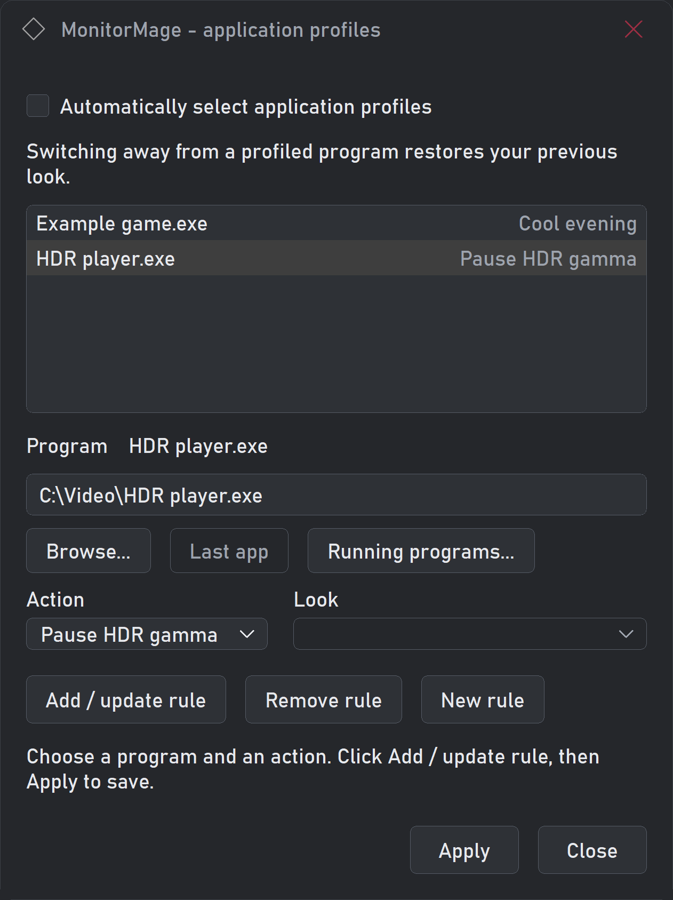
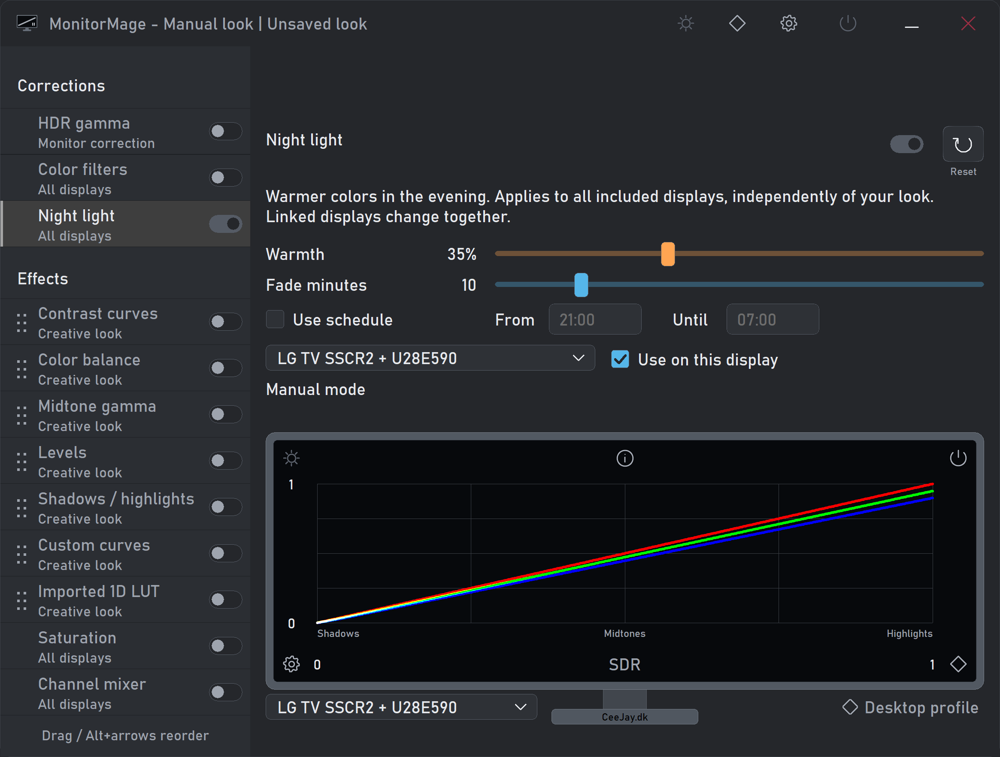

# MonitorMage

MonitorMage is a small Windows tray app for changing the colors and brightness
of your screen. You can combine effects, save your own looks and switch looks
automatically when you use different programs.

I wanted a tool I could leave running quietly while working, gaming or watching
movies. MonitorMage uses existing Windows color controls, so it does not need
to inject shaders into games. My aim is to keep it small and efficient.

**[Download the first beta](https://github.com/CeeJayDK/MonitorMage/releases/tag/v0.111.2-beta.1)**
· [Report a problem](https://github.com/CeeJayDK/MonitorMage/issues)
· [Step-by-step guide](BETA_README.txt)

This is **Beta 1**. I would appreciate feedback, especially from people using
different graphics cards, displays and games.

*The editor with example curve settings. Click an effect's name to open its controls.*

## Get started

1. Open the [beta release page](https://github.com/CeeJayDK/MonitorMage/releases/tag/v0.111.2-beta.1)
   and download **MonitorMage-0.111.2-beta1.zip** under **Assets**.
   The source-code ZIP is for building the program yourself.
2. Extract the whole ZIP into a folder you can save files in, such as Documents.
3. Double-click **MonitorMage.exe**. There is no installer or .NET requirement.
4. Choose **Gentle contrast** from the dropdown near the top.
5. Click **Contrast curves** on the left and try its slider.
6. Click the power icon to compare with your previous colors.

On the first run, master power is on and the individual effects are off until
you choose a look or turn an effect on. The switch beside an effect turns it on
or off; clicking its name opens its settings.

## What can it do?

| Control | What it does |
| --- | --- |
| Contrast curves | Makes dark and bright tones stand apart, using a smooth curve. |
| Color balance | Adjusts red, green, blue, warmth and tint. |
| Midtone gamma | Makes the middle tones brighter or darker. |
| Levels and Shadows/highlights | Adjusts the dark and bright parts of the picture. |
| Custom curves | Lets you shape the overall curve or each color separately. |
| Imported 1D LUT | Loads color curves saved by other tools. |
| Saturation | Makes colors weaker or stronger. |
| Channel mixer | Makes black-and-white looks with control over how light each color becomes. |
| HDR gamma | Adjusts ordinary content while Windows HDR is on. |
| Night light | Makes the picture warmer, manually or on a schedule. |

Example looks include **Warm glow**, **Cool evening**, **Grayscale** and
**Red filter B&W**. You can combine effects and drag the supported effects into
a different order.

## Save a look and make comparisons

1. Choose a look and adjust it.
2. Click **Save as** to give your own look a name.
3. Use **Save** to keep later changes. Check **Autosave** if you want changes
   saved as you make them. Leave it off when experimenting.
4. Use **Revert** to return to the saved look. **Reset** below an effect's name
   resets only that effect.

Right-click or double-click a slider to reset that value. In Custom curves,
double-click a point to reset it, or right-click the graph to reset the selected curve.

**Bypass look** pauses creative effects while keeping corrections such as Night
light. The power button pauses MonitorMage's adjustments together. You can set
a global bypass shortcut in **Settings**; the tray menu also shows that shortcut.

To share a look, open **Settings > Preset folder** and find its file in
**presets/looks**. Put a shared look in that folder and reopen the editor to use it.

## Give a program its own look

1. Save a look for the program.
2. Click the diamond icon to open **Application profiles**.
3. Check **Automatically select application profiles**.
4. Click **Running programs** to choose a program that is open, or use **Browse**.
5. Set **Action** to **Use look**, then choose the saved look.
6. Click **Add / update rule**, then **Apply**.

When you switch away from that program, MonitorMage returns to your previous
look. Other actions can pause effects, pause HDR gamma or pause MonitorMage.

*Example application rules. Your own programs and looks appear here.*

## Warmer colors in the evening

1. Open **Night light** under Corrections and turn it on.
2. Adjust **Warmth**.
3. Check **Use schedule** and enter **From** and **Until** times in 24-hour form.
4. Set **Fade minutes** for a gradual change.
5. Choose which displays receive it using **Use on this display**.

## Leave it running in the tray

- Left-click the tray icon to open the editor.
- The editor's **X** hides the window. To stop the app, right-click its tray icon
  and choose **Exit**.
- In **Settings**, check **Start with Windows** and **Start minimized** to start
  quietly when you sign in. Your saved look works before you open the editor.
- Settings are saved in **MonitorMage.ini** beside the app. Keep that file and
  your **presets** folder if you move the program.

Extra MonitorMage processes in Task Manager help restore your previous colors
if the main app crashes. You only need to start MonitorMage.exe once.

## Requirements and current limits

- A 64-bit Windows PC running Windows 10 or Windows 11.
- HDR gamma currently requires a supported **NVIDIA** display configuration.
  My HDR testing so far has used a GTX 1660 and LG OLED B2 on Windows 10.
- Saturation and Channel mixer affect **all displays**. Some fullscreen games
  skip these effects; try the game's Borderless or Windowed mode if needed.
- Other effects use the selected display group. Duplicated displays can share
  adjustments. Night light has its own display choices.
- Windows Color filters is a separate Windows setting. MonitorMage's power
  button and Exit do not turn that Windows feature off.
- General **3D LUTs**, adaptive vibrance and gamut expansion are not included.
  The graph and LUT export show the separate RGB curves, not matrix effects.

Hardware testing is ongoing. The [test checklist](BETA_CHECKLIST.txt) has short
checks you can try. If something goes wrong, [open an issue](https://github.com/CeeJayDK/MonitorMage/issues)
with what you did, what happened, the app version, Windows version, graphics
card and display setup. Please read any diagnostic report before sharing it;
it can contain display details and program names. Reports are not uploaded automatically.

## Build from source

See [BUILDING.md](BUILDING.md) for the build requirements and commands.
You do not need the source code or developer tools to use the beta download.

The first beta package is **0.111.2**. Its executable displays **0.111.0** because
the later package revisions changed documentation and licensing, not the program.

## License

The [license](LICENSE.txt) allows use and free distribution under its terms.
Paid distribution needs separate permission. Please keep the full license with
copies of the software and read it before redistributing a modified version.

Made by [CeeJay.dk](https://CeeJay.dk).
